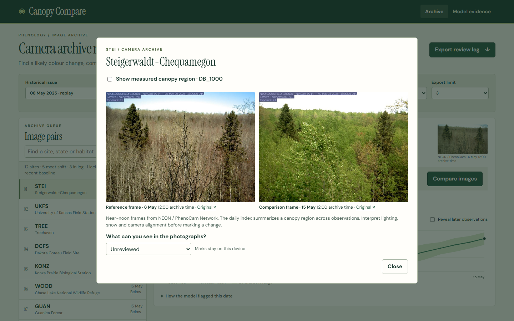

# Canopy Compare

Canopy Compare is a static browser tool for auditing ecological phenology forecasts against real NEON / PhenoCam camera archives. It ranks candidate sites using historical forecast uncertainty, pairs each flag with dated near-noon photographs and verified canopy masks, keeps ground-truth indices hidden until you finish inspecting the imagery, and exports a traceable CSV review log.

## Quick start

Open [`index.html`](index.html) directly in any modern browser. All 208 archived photographs, verified sampling-region overlays, forecasts, and held-out observations load locally from `data/bundle.js` and `data/regions.js` with no server, account, or API key required. (Clicking external links to full-resolution PhenoCam archives requires internet access.)

## Two real cases to try

1. **Spring green-up (`STEI`, 8–15 May 2025):** Select the `08 May 2025` issue and `Greenness · GCC`. **STEI** (Steigerwaldt-Chequamegon, Wisconsin) ranks first. Click **Compare images** to inspect the `6 May` and `15 May` photographs side by side, toggle **Show measured canopy region** to see the exact PhenoCam sampling area, record a visual note, and then enable **Reveal later observations**. Against a four-day baseline of `0.35067`, the model expected `0.39732` (`+0.04665`), while the observed `gcc_90` climbed to `0.44603` (`+0.09536`).
2. **Autumn senescence miss (`TREE`, 9–16 Oct 2025):** Switch to `09 Oct 2025` and `Redness · RCC`. **TREE** (Treehaven, Wisconsin) ranks first, where the model predicted a drop from `0.50248` to `0.41969` (`-0.08279`). Revealing later observations shows `rcc_90` actually rose slightly to `0.51467` (`+0.01219`). Opening the paired frames lets you judge whether lighting, camera geometry, or canopy heterogeneity explains the miss.
3. **Export review log:** Click **Export review log** to download a CSV containing rankings, thresholds, forecast means and standard deviations, observed values, your visual marks (persisted in `localStorage` or kept in session memory if storage is disabled), and links to both original PhenoCam photographs.



### Verifying the measured canopy region

Each PhenoCam color index summarizes pixels inside a specific vegetation mask rather than the entire photograph. When you toggle **Show measured canopy region**, Canopy Compare overlays the dated binary mask (gold outline with dimmed background) and links directly to the original TIFF mask source—while keeping ground-truth observations hidden so visual inspection stays blind. [Measured region overlay on the STEI spring pair](evidence/measured-region.png)

To ensure overlays align with the exact region behind the published daily index, I cross-checked all 208 photos across the 14 sites against PhenoCam's mask registry and midday RGB summaries:

- **197 frames** matched a single dated mask that reproduced all three published midday R, G, and B channel averages within 1 count on the `0–255` scale (including 16 frames where two candidate masks existed and the RGB check uniquely resolved the right one).
- Across those 197 verified frames, the median max-channel difference from PhenoCam's published RGB was **0.0042** inside the mask vs. **32.95** across the full frame.
- For the remaining **11 frames** (1 with a mismatched archive filename and 10 outside the 1-count tolerance), the app displays the unmodified photograph without drawing an unverified mask.

I also tested the blind review workflow directly on the STEI spring pair before looking at the observed numbers, confirming visible leaf-out within the outlined broadleaf canopy and keeping the greening flag ([entrant-review.md](evidence/entrant-review.md)).

[Autumn forecast compared with observations](evidence/autumn-miss.png) · [Exported review log preview](evidence/review-log.png)

## How candidate dates are ranked

For each historical issue date, a gradient-boosted tree model predicts a correction to seasonal history and historical-analogue trajectories using both `gcc_90` and `rcc_90`, recent trends, site metadata, and forecast horizon, enforcing a two-day observation lag. The four-day baseline is the median of observations ending on each site's last reported day before the issue.

Each eligible candidate (requiring a baseline within 7 days and two locally verified archive photos) is scored as:

```text
conservative_shift = |forecast_mean − baseline| − 0.84162 × forecast_sd
```

Under a fitted normal-error assumption, this equals a one-sided 80% lower bound on expected color change in the predicted direction. Later ground-truth values are never read by the ranking code.

## Retrospective validation (2024–2026)

Models were trained on target dates prior to 2023, and error scales were calibrated on 2023 across 14 active NEON sites. Note that EFI's published target archive contains provisional historical records that can be revised retrospectively; this replay models the two-day reporting lag against the frozen snapshot in `model/`.

| Forecast year | Scored site/day/index values¹ | Model CRPS | Last observed colour CRPS | Seasonal CRPS |
|---|---:|---:|---:|---:|
| 2024 | 20,834 | 0.00778 | 0.01133 | 0.00960 |
| 2025 | 20,054 | 0.00741 | 0.01035 | 0.00947 |
| 2026 | 18,044 | 0.00741 | 0.01066 | 0.00950 |

¹Includes issue and target dates falling within the listed year (lower CRPS is better). Across all **60,014** archived verified values including cross-year horizons, nominal central 80% prediction intervals covered **82.88%** of green and **86.45%** of red observations.

To test decision quality rather than point error alone, I evaluated top-three weekly picks across **74 biweekly issues** from January 2024 to October 2026 (222 selections per policy, restricted to matching sites with seven verifying days, two usable pre-issue windows, and at least six available sites). A pick counts as a hit if the observed absolute index shift from the decision-time baseline is at least `0.010`:

| Review policy | Green hits | Mean absolute green shift | Red hits | Mean absolute red shift |
|---|---:|---:|---:|---:|
| Planner chooses day | 37.39% | 0.01235 | 56.76% | 0.02472 |
| Predicted change without uncertainty discount | 35.14% | 0.01208 | 61.71% | 0.02556 |
| Planner ranks sites on day seven | 39.64% | 0.01292 | 54.95% | 0.02553 |
| Recent trend, day seven | 32.88% | 0.01081 | 59.91% | 0.02348 |

Subtracting the `0.84162 × sd` uncertainty margin improved green-up hit rate by `+2.25` percentage points over ranking by predicted change alone (`+4.51` points over recent trend), while trading off `-4.95` points on autumn redness where rapid senescence carries higher predictive variance. As the October `TREE` case shows, index shifts can arise from lighting, snow, shadows, or camera drift—so human inspection of the actual frames remains essential.

## Reproducing from scratch

The static viewer works offline out of the box. To rebuild the model predictions, browser bundles, and ROI overlays on CPU (Python 3.12):

```text
python -m pip install -r requirements.txt
python model/forecast.py --issue 2026-11-26
python prepare.py
```

- `model/` bundles the frozen EFI target archive (`phenology-targets.csv.gz`) and provenance metadata (`model/source.json`).
- `prepare.py` regenerates `data/bundle.js` and the 74-issue decision evaluation (`evidence/decision_validation.json`); pass `--images` to re-fetch archive JPEGs recorded in `data/images.json`.
- `python prepare_regions.py --cache ../roi-cache` re-downloads PhenoCam mask registries, binary TIFF masks, and daily RGB summaries to verify `data/regions.js` and `evidence/region_verification.json`. See [`DATA.md`](DATA.md) for full data and font attributions.
- Automated UI regression checks use Playwright (`python -m pip install playwright==1.64.1 && python -m playwright install chromium --only-shell`): run `python evidence/check_ui.py` to reproduce [`evidence/ui_checks.json`](evidence/ui_checks.json). The demo recording automation lives under `evidence/demo/`.

## Development & AI disclosure

The core phenology forecast pipeline and held-out backtests existed prior to the event. During the hackathon, I designed the browser-based archive review workflow for remote laptop operation, restricted candidates to completed historical windows with verified before/after image pairs, added blind visual annotation and ROI overlays, and compiled the 74-issue prioritization evaluation.

AI coding tools (OpenAI Codex and Antigravity assistants) helped write the static web interface, ROI RGB verification scripts, Playwright regression tests, documentation revisions, and demo recording pipeline. The runtime application runs gradient-boosted regression outputs locally in JavaScript with no generative AI calls or external services. NEON, the PhenoCam Network, and EFI provided the underlying imagery and ecological targets; all reported metrics come from local retrospective evaluations.
